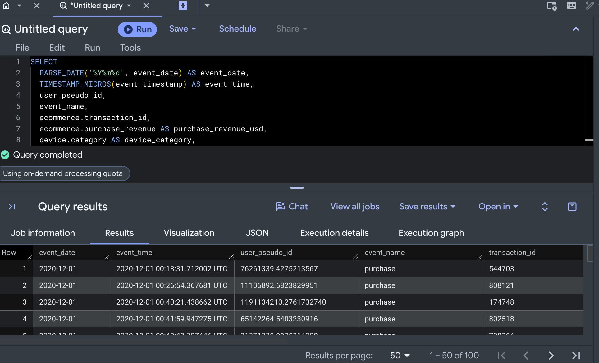
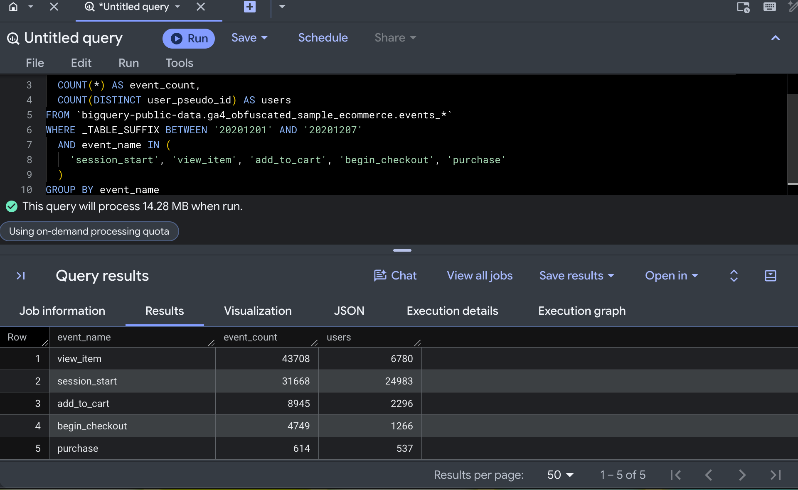
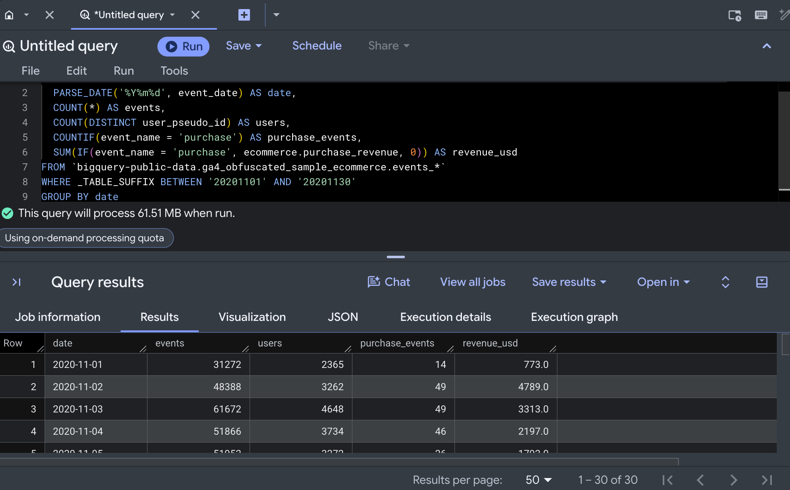
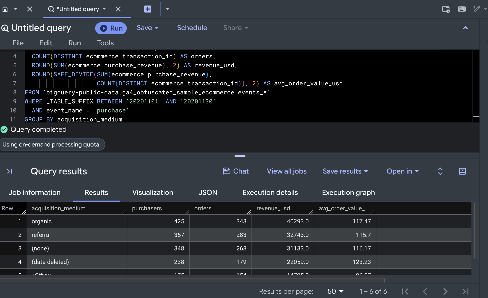
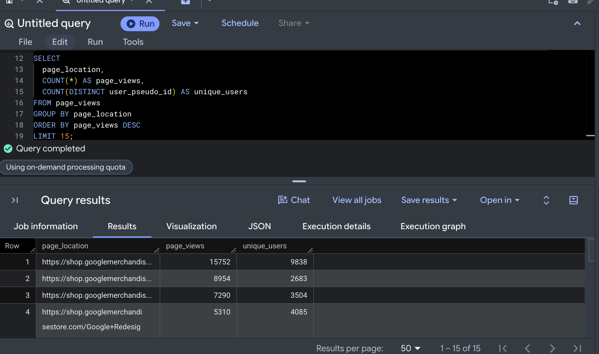
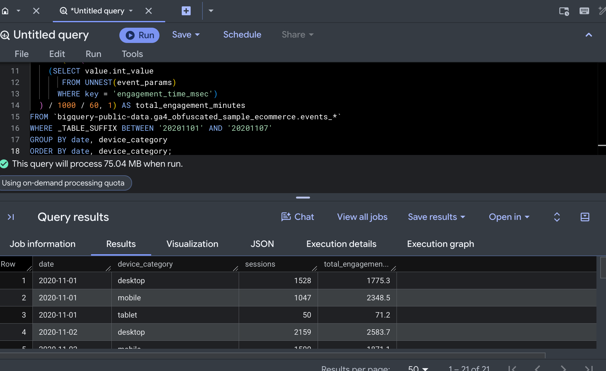
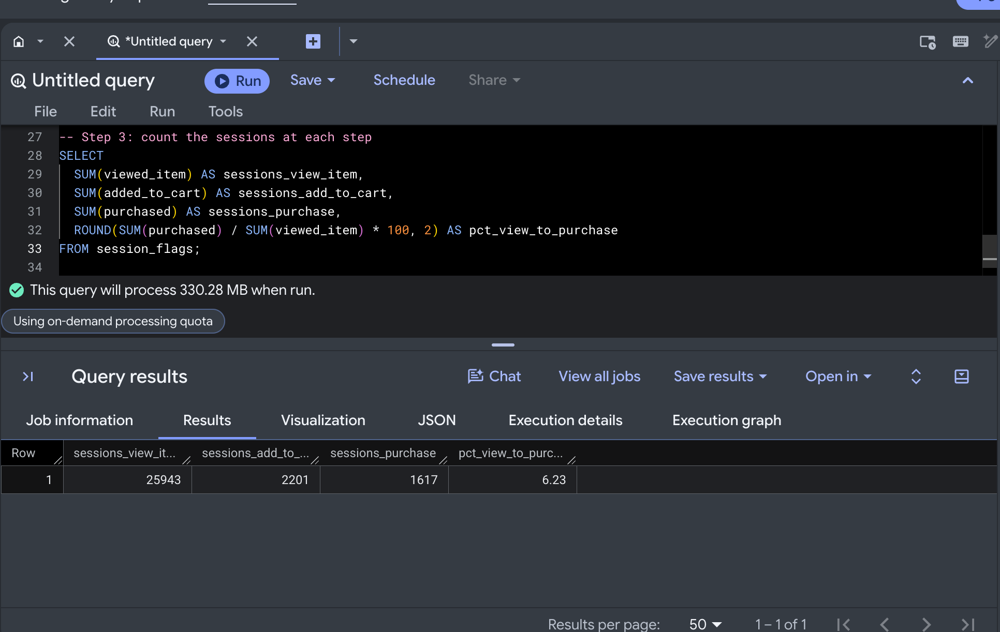
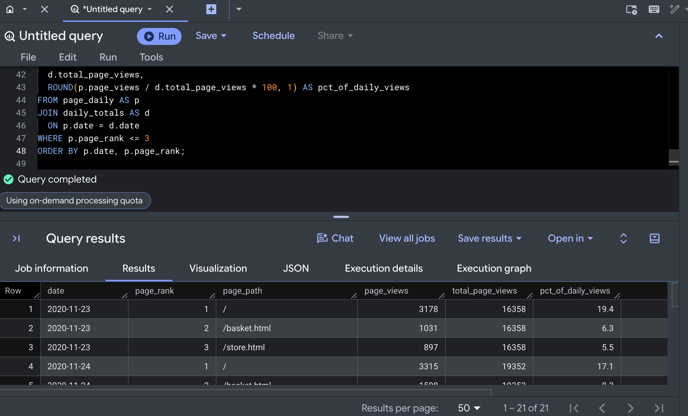

# Overview

## Purpose

This SQL Pack demonstrates that I can write and interpret BigQuery GoogleSQL on GA4 export data, including the core GA4 pattern of extracting parameters from `event_params` with `UNNEST`.
The eight queries below are meaningfully distinct, and each one is followed by a short explanation.

## Data Source

All queries run against the public GA4 sample e-commerce export (Google Merchandise Store):

`bigquery-public-data.ga4_obfuscated_sample_ecommerce.events_*`

This is a date-sharded table covering **2020-11-01 through 2021-01-31**.
Every query limits the scan with `_TABLE_SUFFIX` so BigQuery only reads the daily shards needed.

## Skill Coverage Map

| Query | Topic | A. Filter/Scope | B. Group/Aggregate | C. UNNEST | D. CTE | E. Join/Combine |
|:----------|:----------|:---------:|:---------:|:---------:|:---------:|:---------:|
| 1 | Purchase event preview | ✔ |  |  |  |  |
| 2 | Funnel event volume by event name | ✔ | ✔ |  |  |  |
| 3 | Daily KPI summary |  | ✔ |  |  |  |
| 4 | Revenue and AOV by acquisition medium |  | ✔ |  |  |  |
| 5 | Top pages by page views |  |  | ✔ |  |  |
| 6 | Daily sessions and engagement time |  |  | ✔ |  |  |
| 7 | Session-level purchase funnel |  |  |  | ✔ | ✔ |
| 8 | Page share of daily page views |  |  | ✔ | ✔ | ✔ |

## A Note on Definitions

- **Event** = one row in the export, counted with `COUNT(*)`.
- **User** = `COUNT(DISTINCT user_pseudo_id)`.
- **Session** = a unique combination of `user_pseudo_id` and the `ga_session_id` event parameter (`ga_session_id` alone is *not* unique across users).
- `event_date` is stored as a `STRING` in `YYYYMMDD` format, so I convert it with `PARSE_DATE` when I need a real date.

# Deliverable 1: The Eight Queries

## Query 1: Preview of Purchase Events (Filtering and Scoping)

``` sql
-- Query 1: Preview purchase events for one week
-- Skill: Filtering and scoping (date range + event_name)
SELECT
  PARSE_DATE('%Y%m%d', event_date) AS event_date,
  TIMESTAMP_MICROS(event_timestamp) AS event_time,
  user_pseudo_id,
  event_name,
  ecommerce.transaction_id,
  ecommerce.purchase_revenue AS purchase_revenue_usd,
  device.category AS device_category,
  geo.country AS country
FROM `bigquery-public-data.ga4_obfuscated_sample_ecommerce.events_*`
WHERE _TABLE_SUFFIX BETWEEN '20201201' AND '20201207'  -- only scan 7 daily shards
  AND event_name = 'purchase'                          -- only purchase events
ORDER BY event_time
LIMIT 100;
```



**This query answers:** what do raw purchase events look like during the first week of December 2020?
**It works by:** limiting the scan to seven daily tables with `_TABLE_SUFFIX`, then keeping only `event_name = 'purchase'` and selecting the transaction, revenue, device, and country fields.
**You'd use it when:** you are exploring a new export and want to sanity-check the purchase fields before building anything on top of them.
**Caveat:** the `_TABLE_SUFFIX` filter is what controls cost and speed, since `LIMIT` does not reduce bytes scanned.
Also, one purchase can appear on more than one row if the tag fired twice, so transactions should be deduplicated on `transaction_id` before being reported.

## Query 2: Funnel Event Volume by Event Name (Filtering and Grouping)

``` sql
-- Query 2: Event volume for key e-commerce events, one week
-- Skills: Filtering (date range, event_name list) + grouping
SELECT
  event_name,
  COUNT(*) AS event_count,
  COUNT(DISTINCT user_pseudo_id) AS users
FROM `bigquery-public-data.ga4_obfuscated_sample_ecommerce.events_*`
WHERE _TABLE_SUFFIX BETWEEN '20201201' AND '20201207'
  AND event_name IN (
    'session_start', 'view_item', 'add_to_cart', 'begin_checkout', 'purchase'
  )
GROUP BY event_name
ORDER BY event_count DESC;
```



**This query answers:** how many times, and for how many distinct users, does each key shopping event occur in a week?
**It works by:** filtering to a short list of funnel events with `IN (...)`, then grouping by `event_name` and returning both `COUNT(*)` (events) and `COUNT(DISTINCT user_pseudo_id)` (users).
**You'd use it when:** you want a quick read on the shape of the funnel and need to see where volume drops off.
**Caveat:** the event count and user count answer different questions (one user can fire `view_item` many times), so the ratio between them is a rough measure of repeat behavior rather than a conversion rate.

## Query 3: Daily KPI Summary (Grouping and Aggregation)

``` sql
-- Query 3: Daily KPI summary for November 2020
-- Skills: GROUP BY with COUNT(*), COUNT(DISTINCT), COUNTIF, SUM
SELECT
  PARSE_DATE('%Y%m%d', event_date) AS date,
  COUNT(*) AS events,
  COUNT(DISTINCT user_pseudo_id) AS users,
  COUNTIF(event_name = 'purchase') AS purchase_events,
  SUM(IF(event_name = 'purchase', ecommerce.purchase_revenue, 0)) AS revenue_usd
FROM `bigquery-public-data.ga4_obfuscated_sample_ecommerce.events_*`
WHERE _TABLE_SUFFIX BETWEEN '20201101' AND '20201130'
GROUP BY date
ORDER BY date;
```



**This query answers:** how did overall traffic, purchases, and revenue move day by day in November 2020?
**It works by:** grouping all events by date and computing four metrics: total events with `COUNT(*)`, unique users with `COUNT(DISTINCT ...)`, purchase events with `COUNTIF`, and revenue with a conditional `SUM`.
**You'd use it when:** you need a daily trend table for a dashboard or to spot spikes such as Black Friday and Cyber Monday.
**Caveat:** `events` is not the same as users or sessions, so it should not be used as a traffic measure on its own.
Daily users are distinct *within each day*, which means summing them across days double counts returning users.

## Query 4: Revenue and Average Order Value by Acquisition Medium (Grouping and Aggregation)

``` sql
-- Query 4: Purchasers, orders, revenue, and AOV by acquisition medium
-- Skills: GROUP BY, COUNT(DISTINCT), SUM, SAFE_DIVIDE
SELECT
  traffic_source.medium AS acquisition_medium,
  COUNT(DISTINCT user_pseudo_id) AS purchasers,
  COUNT(DISTINCT ecommerce.transaction_id) AS orders,
  ROUND(SUM(ecommerce.purchase_revenue), 2) AS revenue_usd,
  ROUND(SAFE_DIVIDE(SUM(ecommerce.purchase_revenue),
                    COUNT(DISTINCT ecommerce.transaction_id)), 2) AS avg_order_value_usd
FROM `bigquery-public-data.ga4_obfuscated_sample_ecommerce.events_*`
WHERE _TABLE_SUFFIX BETWEEN '20201101' AND '20201130'
  AND event_name = 'purchase'
GROUP BY acquisition_medium
ORDER BY revenue_usd DESC;
```



**This query answers:** which acquisition mediums bring in the most purchasers, orders, and revenue, and which bring the highest-value orders?
**It works by:** filtering to purchase events, grouping by `traffic_source.medium`, and computing distinct purchasers, distinct orders, total revenue, and average order value, using `SAFE_DIVIDE` to avoid divide-by-zero errors.
**You'd use it when:** comparing channel quality for budget decisions, where volume (orders) and value (AOV) tell different stories.
**Caveat:** in GA4 exports, `traffic_source` is the user's *first-touch* acquisition source, not the source of the session in which the purchase happened, so this is a first-touch view and not session attribution.
Some values appear as `(none)` or `<Other>` because of how the sample data was obfuscated.

## Query 5: Top Pages by Page Views (UNNEST Event Parameters)

``` sql
-- Query 5: Top 15 pages by page views
-- Skills: UNNEST(event_params) with key = 'page_location' and string_value
WITH page_views AS (
  SELECT
    user_pseudo_id,
    (SELECT value.string_value
       FROM UNNEST(event_params)
      WHERE key = 'page_location') AS page_location
  FROM `bigquery-public-data.ga4_obfuscated_sample_ecommerce.events_*`
  WHERE _TABLE_SUFFIX BETWEEN '20201201' AND '20201207'
    AND event_name = 'page_view'
)
SELECT
  page_location,
  COUNT(*) AS page_views,
  COUNT(DISTINCT user_pseudo_id) AS unique_users
FROM page_views
GROUP BY page_location
ORDER BY page_views DESC
LIMIT 15;
```



**This query answers:** which URLs received the most page views during the first week of December 2020?
**It works by:** filtering to `page_view` events, then using a correlated subquery over `UNNEST(event_params)` to pull the value where `key = 'page_location'`.
Because a URL is text, the value comes from `string_value`, not `int_value` or `double_value`.
**You'd use it when:** you need content or landing page rankings, which cannot be read straight from a top-level column because the URL lives inside the repeated `event_params` field.
**Caveat:** raw `page_location` values include query strings (for example, tracking parameters), so the same page can appear as several rows.
Query 8 cleans the URL down to a path to address this.

## Query 6: Daily Sessions and Engagement Time by Device (UNNEST Event Parameters)

``` sql
-- Query 6: Sessions and engagement time by day and device category
-- Skills: UNNEST(event_params) with int_value keys (ga_session_id, engagement_time_msec)
SELECT
  PARSE_DATE('%Y%m%d', event_date) AS date,
  device.category AS device_category,
  COUNT(DISTINCT CONCAT(
    user_pseudo_id, '-',
    CAST((SELECT value.int_value
            FROM UNNEST(event_params)
           WHERE key = 'ga_session_id') AS STRING)
  )) AS sessions,
  ROUND(SUM(
    (SELECT value.int_value
       FROM UNNEST(event_params)
      WHERE key = 'engagement_time_msec')
  ) / 1000 / 60, 1) AS total_engagement_minutes
FROM `bigquery-public-data.ga4_obfuscated_sample_ecommerce.events_*`
WHERE _TABLE_SUFFIX BETWEEN '20201101' AND '20201107'
GROUP BY date, device_category
ORDER BY date, device_category;
```



**This query answers:** how many sessions occurred each day on each device type, and how much total engaged time did they generate?
**It works by:** extracting `ga_session_id` and `engagement_time_msec` from `event_params`, both of which are stored in `int_value`.
Sessions are counted as distinct combinations of `user_pseudo_id` and `ga_session_id`, and engagement milliseconds are summed then converted to minutes.
**You'd use it when:** you need a session-based metric that the export does not provide as a column, or want to compare how engaged mobile, desktop, and tablet visitors are.
**Caveat:** `ga_session_id` is only unique within a user, so it has to be combined with `user_pseudo_id`.
Engagement time only appears on some events, so the total is a sum of what was recorded rather than a precise stopwatch measure, and it will not exactly match the GA4 interface.

## Query 7: Session-Level Purchase Funnel (CTE and Multi-Step Approach)

``` sql
-- Query 7: Session-level funnel from view_item to purchase
-- Skills: multiple CTEs, UNNEST, conditional aggregation, combining steps
WITH funnel_events AS (
  -- Step 1: build a base event set with a session key
  SELECT
    CONCAT(
      user_pseudo_id, '-',
      CAST((SELECT value.int_value
              FROM UNNEST(event_params)
             WHERE key = 'ga_session_id') AS STRING)
    ) AS session_key,
    event_name
  FROM `bigquery-public-data.ga4_obfuscated_sample_ecommerce.events_*`
  WHERE _TABLE_SUFFIX BETWEEN '20201101' AND '20201130'
    AND event_name IN ('view_item', 'add_to_cart', 'begin_checkout', 'purchase')
),
session_steps AS (
  -- Step 2: one row per session, flagging which steps were reached
  SELECT
    session_key,
    MAX(IF(event_name = 'view_item', 1, 0)) AS viewed_item,
    MAX(IF(event_name = 'add_to_cart', 1, 0)) AS added_to_cart,
    MAX(IF(event_name = 'begin_checkout', 1, 0)) AS began_checkout,
    MAX(IF(event_name = 'purchase', 1, 0)) AS purchased
  FROM funnel_events
  GROUP BY session_key
)
-- Step 3: summarize the funnel and calculate step-to-step rates
SELECT
  SUM(viewed_item) AS sessions_view_item,
  SUM(added_to_cart) AS sessions_add_to_cart,
  SUM(began_checkout) AS sessions_begin_checkout,
  SUM(purchased) AS sessions_purchase,
  ROUND(SAFE_DIVIDE(SUM(added_to_cart), SUM(viewed_item)) * 100, 1) AS pct_view_to_cart,
  ROUND(SAFE_DIVIDE(SUM(began_checkout), SUM(added_to_cart)) * 100, 1) AS pct_cart_to_checkout,
  ROUND(SAFE_DIVIDE(SUM(purchased), SUM(began_checkout)) * 100, 1) AS pct_checkout_to_purchase,
  ROUND(SAFE_DIVIDE(SUM(purchased), SUM(viewed_item)) * 100, 2) AS pct_view_to_purchase
FROM session_steps;
```



**This query answers:** of the sessions that viewed a product in November 2020, what share moved on to add to cart, begin checkout, and purchase?
**It works by:** using one CTE to extract a session key from `event_params`, a second CTE to collapse each session into 0/1 flags per funnel step, and a final `SELECT` that sums the flags and divides step to step.
**You'd use it when:** you need to find the biggest drop-off in the purchase path, and want logic that a teammate can extend by adding a step or a segment column.
**Caveat:** this is an "any order" funnel, meaning a session counts at a step if the event occurred at all, whether or not it followed the earlier step.
Events that are missing a `ga_session_id` get a `NULL` session key and would be lumped together as one "session", so it is worth checking for missing IDs before relying on the funnel.

## Query 8: Page Share of Daily Page Views (CTEs, Join, UNNEST)

``` sql
-- Query 8: Top 3 pages per day with share of that day's page views
-- Skills: UNNEST, CTEs, JOIN of a derived table back to a daily aggregate
WITH page_views AS (
  -- Event-level extraction: clean page path from page_location
  SELECT
    PARSE_DATE('%Y%m%d', event_date) AS date,
    REGEXP_EXTRACT(
      (SELECT value.string_value
         FROM UNNEST(event_params)
        WHERE key = 'page_location'),
      r'https?://[^/]+(/[^?#]*)'
    ) AS page_path
  FROM `bigquery-public-data.ga4_obfuscated_sample_ecommerce.events_*`
  WHERE _TABLE_SUFFIX BETWEEN '20201123' AND '20201129'  -- Thanksgiving week
    AND event_name = 'page_view'
),
page_daily AS (
  -- Daily views per page
  SELECT date, page_path, COUNT(*) AS page_views
  FROM page_views
  GROUP BY date, page_path
),
daily_totals AS (
  -- Daily aggregate of all page views
  SELECT date, COUNT(*) AS total_page_views
  FROM page_views
  GROUP BY date
)
SELECT
  p.date,
  p.page_path,
  p.page_views,
  d.total_page_views,
  ROUND(SAFE_DIVIDE(p.page_views, d.total_page_views) * 100, 1) AS pct_of_daily_views
FROM page_daily AS p
JOIN daily_totals AS d
  ON p.date = d.date
QUALIFY ROW_NUMBER() OVER (PARTITION BY p.date ORDER BY p.page_views DESC) <= 3
ORDER BY p.date, p.page_views DESC;
```



**This query answers:** on each day of Thanksgiving week 2020, which three pages drew the most views, and how much of that day's traffic did each one capture?
**It works by:** extracting `page_location` with `UNNEST(event_params)`, cleaning it to a path with `REGEXP_EXTRACT`, building a per-page daily count and a daily total in separate CTEs, then joining them on `date` to calculate each page's share.
`QUALIFY` with `ROW_NUMBER()` keeps the top three per day.
**You'd use it when:** you want to see whether traffic is concentrating on a few pages (such as the home page or a sale page) during a promotional period.
**Caveat:** stripping the query string merges URL variants into one path, which is usually what you want for content analysis, but it hides campaign tags.
Pages whose URL does not match the pattern return `NULL` for `page_path`, and those rows still count in the daily total.

# Reflection

Writing these queries showed me how much of GA4 analysis depends on correct definitions rather than syntax.
The same table can produce events, users, or sessions depending on what is counted, and the key details in the export (the date-sharded tables, the repeated `event_params` field, and the choice among `string_value`, `int_value`, and `double_value`) are exactly where mistakes happen.
Filtering with `_TABLE_SUFFIX` early and extracting parameters inside a CTE made the queries cheaper to run and easier to read, which are habits I can carry into the team's mart in Milestone 5, the R pipeline in Milestone 7, and the path-building work for attribution in Milestone 9.

# Appendix

## Links

- **GitHub Repository:** [PASTE REPO LINK HERE](https://github.com/rubencgarcia/REPLACE-WITH-REPO-NAME)
- **GitHub Pages:** [PASTE PAGES LINK HERE](https://rubencgarcia.github.io/REPLACE-WITH-REPO-NAME/)

## Files Submitted

- `Garcia-Ruben-milestone4-sql-pack.qmd`
- `Garcia-Ruben-milestone4-sql-pack.html`
- `Garcia-Ruben-milestone4-sql-pack.sql` (all eight queries in one file)
